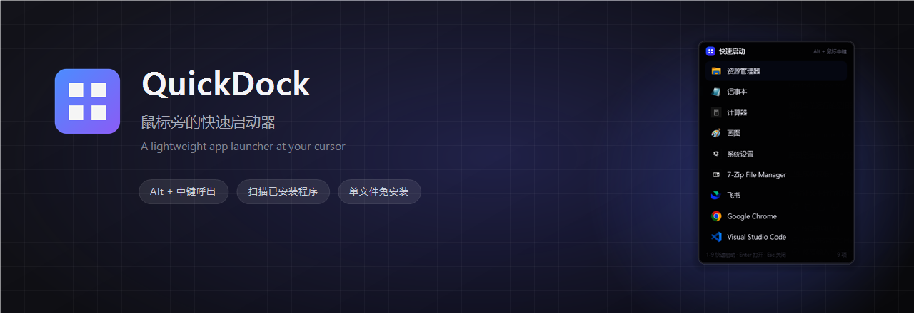
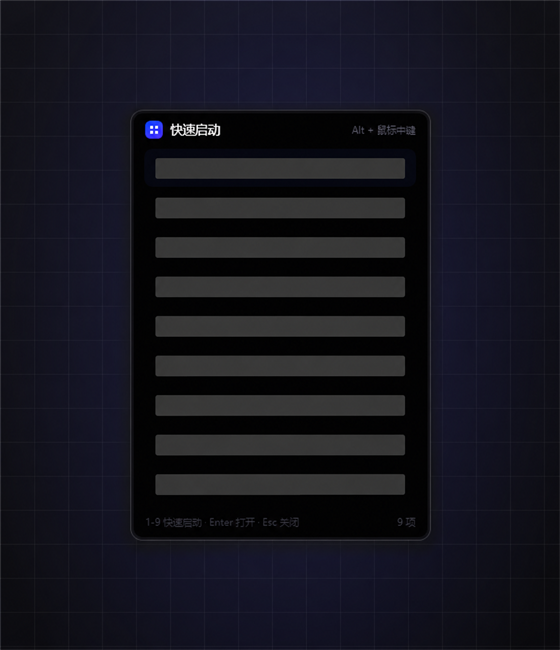
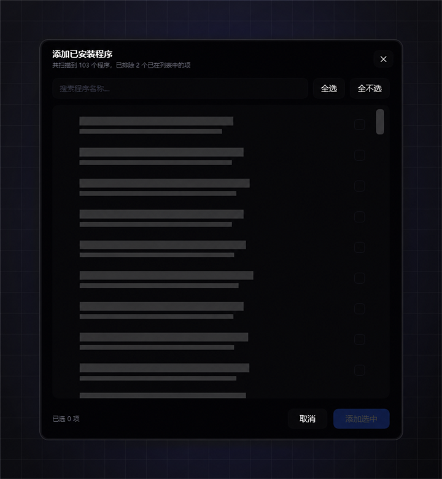
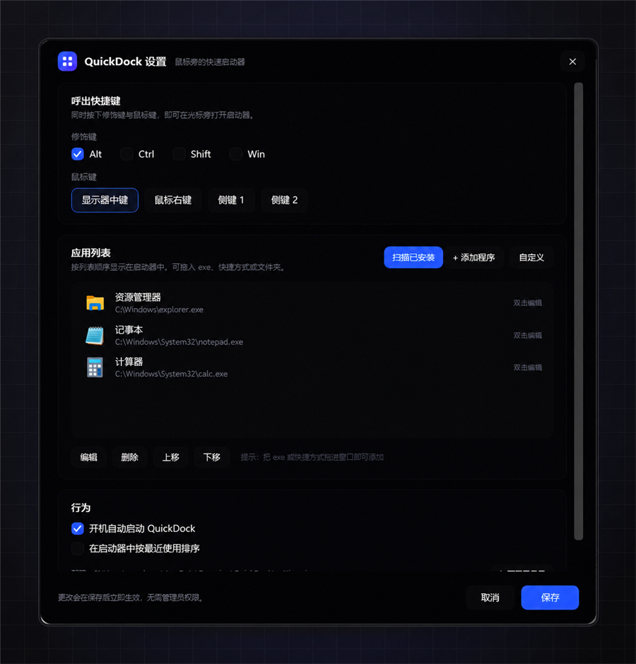

# QuickDock

**简体中文** | [English](#english)



Windows 上轻巧的鼠标旁快速启动器。按下 `Alt + 鼠标中键`（可自定义），常用软件列表就会出现在光标附近，点一下即可打开。

A lightweight Windows launcher that appears right at your cursor. Press `Alt + middle mouse button` (customizable) and click an app to launch it.

---

## 中文

### 效果预览

**呼出面板**



**扫描已安装程序**



**设置**



### 功能

- 全局鼠标快捷键：默认 `Alt + 鼠标中键`，在任意程序中均可呼出
- 紧凑竖向列表（320px 宽，高度随条目自适应），出现在鼠标附近并自动避让屏幕边缘
- 常用软件列表完全自定义：添加 exe、快捷方式、文档、文件夹、网址、`ms-settings:` 等
- 一键扫描电脑已安装的程序，搜索、勾选后批量加入（自动排除卸载程序与系统管理工具）
- 支持 Windows 商店应用（UWP），可直接启动
- 从文件自动读取程序名称与高清图标
- 支持拖放 exe / 快捷方式到设置窗口快速添加
- 方向键选择、`Enter` 打开、数字键 `1-9` 快速启动、`Esc` 关闭
- 可选按最近使用排序
- 开机自动启动、系统托盘常驻、单实例运行
- 中文深色界面，支持高 DPI

### 快速开始

1. 运行 `dist\QuickDock.exe`，程序会常驻系统托盘，不显示任务栏窗口。
2. 在任意位置按 `Alt + 鼠标中键`，启动器会出现在鼠标旁边。
3. 点击图标启动；或按 `1-9`、方向键 + `Enter`。
4. 双击托盘图标或右键托盘菜单「设置…」打开设置。
5. 在设置中可修改：
   - 修饰键：`Alt` / `Ctrl` / `Shift` / `Win`（可多选，至少一个）
   - 鼠标键：中键 / 右键 / 侧键 1 / 侧键 2
   - 应用列表：扫描已安装、手动添加、编辑、删除、排序
   - 开机自启、按最近使用排序

> 快捷键采用精确匹配：配置了 `Alt` 时，按住 `Ctrl + Alt` 再点击不会触发。

### 扫描已安装程序

在设置页点击「扫描已安装」，等待约 1 秒后会列出本机已注册的应用：

- 支持按名称搜索、全选 / 全不选，勾选后点击「添加选中」批量加入
- 已在列表中的程序会被自动跳过
- 自动排除卸载入口、文档、脚本以及 `System32` 下的系统管理工具
- Windows 商店应用（UWP）会以 `shell:AppsFolder\...` 形式加入，可直接启动

### 键盘与鼠标操作

| 操作 | 说明 |
| --- | --- |
| `Alt + 鼠标中键` | 呼出 / 收起启动器（默认，可自定义） |
| `1` - `9` | 启动对应序号的程序 |
| `↑` / `↓` | 切换选中项 |
| `Enter` | 打开选中项 |
| `Esc` | 关闭面板 |

### 配置文件

配置保存在：

```
%APPDATA%\QuickDock\settings.json
```

删除该文件后重启程序可恢复默认列表。错误日志位于同目录的 `error.log`。

### 构建与发布

需要 .NET 10 SDK（WPF）：

```powershell
dotnet build .\src\QuickDock.csproj -c Debug
```

运行调试版本：

```powershell
.\src\bin\Debug\net10.0-windows\QuickDock.exe
```

生成依赖本机 .NET 10 Desktop Runtime 的精简单文件版本：

```powershell
powershell -ExecutionPolicy Bypass -File .\publish.ps1
```

生成包含运行时的独立版本（体积较大，可在未安装 .NET 的电脑上运行）：

```powershell
powershell -ExecutionPolicy Bypass -File .\publish.ps1 -SelfContained
```

输出目录为 `dist\`。默认版本约 250 KB。

### 项目结构

```
src/
  App.xaml / App.xaml.cs            应用入口、托盘、单实例、全局快捷键
  MainWindow.xaml / .cs             鼠标旁的启动器面板
  Models/                           配置与应用条目模型
  Services/
    InstalledAppScanner.cs          扫描本机已安装程序
    MouseHotkeyHook.cs              全局鼠标钩子
    AppLauncher.cs                  程序启动
    IconService.cs                  图标提取
    SettingsService.cs              配置读写
    StartupManager.cs               开机自启
  Views/
    SettingsWindow.xaml / .cs       设置窗口
    InstalledAppsWindow.xaml / .cs  已安装程序选择窗口
    ItemEditWindow.xaml / .cs       单个应用编辑窗口
  Assets/app.ico                    应用图标
docs/images/                        README 效果图
publish.ps1                         发布脚本
```

### 说明与限制

- 快捷启动依赖 `Process.Start` + Shell 执行，因此支持系统注册过的协议与文件关联。
- 全局鼠标钩子无法接收以管理员身份运行的程序窗口内的输入（Windows UIPI 限制）。若需要在管理员程序上方使用，请同样以管理员身份运行 QuickDock。
- 「开机自动启动」写入当前用户注册表 `HKCU\Software\Microsoft\Windows\CurrentVersion\Run`，无需管理员权限。
- 若移动了 exe 位置，请重新勾选一次「开机自动启动」以更新启动路径。

---

## English

### Screenshots

**Launcher popup**


**Scan installed apps**


**Settings**


### Features

- Global mouse hotkey: `Alt + middle mouse button` by default, works in any application
- Compact vertical list (320 px wide, height adapts to the number of items), opens near the cursor and avoids screen edges
- Fully customizable app list: executables, shortcuts, documents, folders, URLs, `ms-settings:` URIs, and more
- One-click scan of installed programs, with search and batch add (uninstallers and Windows management tools are filtered out)
- Supports Windows Store apps (UWP) and launches them directly
- Reads app names and high-resolution icons automatically
- Drag and drop executables or shortcuts onto the settings window to add them
- Keyboard support: arrow keys, `Enter` to launch, `1`-`9` for quick launch, `Esc` to close
- Optional sorting by recent usage
- Run at startup, system tray icon, single-instance behavior
- Dark UI with high-DPI support

### Quick start

1. Run `dist\QuickDock.exe`. It stays in the system tray and does not show a taskbar window.
2. Press `Alt + middle mouse button` anywhere to open the launcher next to the cursor.
3. Click an app, or press `1`-`9`, or use the arrow keys and `Enter`.
4. Double-click the tray icon, or right-click it and choose "Settings..." to configure QuickDock.
5. In settings you can change:
   - Modifier keys: `Alt` / `Ctrl` / `Shift` / `Win` (at least one)
   - Mouse button: middle / right / side button 1 / side button 2
   - App list: scan installed apps, add, edit, delete, reorder
   - Launch at startup and sort by recent usage

> The hotkey uses exact modifier matching. If `Alt` is configured, `Ctrl + Alt` plus the mouse button will not trigger the launcher.

### Scan installed apps

Click "Scan installed" in the settings window. After about a second, all registered applications on the machine are listed:

- Search by name, select all / none, then click "Add selected" to add them in bulk
- Apps already in the list are skipped automatically
- Uninstallers, documents, scripts, and Windows management tools under `System32` are filtered out
- Windows Store apps (UWP) are added as `shell:AppsFolder\...` entries and can be launched directly

### Keyboard and mouse

| Action | Description |
| --- | --- |
| `Alt + middle mouse` | Show / hide the launcher (default, customizable) |
| `1` - `9` | Launch the app at that position |
| `Up` / `Down` | Change the selected item |
| `Enter` | Launch the selected item |
| `Esc` | Close the launcher |

### Configuration

Settings are stored at:

```
%APPDATA%\QuickDock\settings.json
```

Delete this file and restart QuickDock to restore the default list. Error logs are written to `error.log` in the same folder.

### Build and publish

Requires the .NET 10 SDK (WPF):

```powershell
dotnet build .\src\QuickDock.csproj -c Debug
```

Run the debug build:

```powershell
.\src\bin\Debug\net10.0-windows\QuickDock.exe
```

Create a small single-file build that depends on the .NET 10 Desktop Runtime:

```powershell
powershell -ExecutionPolicy Bypass -File .\publish.ps1
```

Create a self-contained build that runs without .NET installed (larger file size):

```powershell
powershell -ExecutionPolicy Bypass -File .\publish.ps1 -SelfContained
```

The output is written to `dist\`. The framework-dependent build is about 250 KB.

### Project structure

```
src/
  App.xaml / App.xaml.cs            Entry point, tray icon, single instance, global hotkey
  MainWindow.xaml / .cs             Cursor-side launcher panel
  Models/                           Settings and launcher item models
  Services/
    InstalledAppScanner.cs          Enumerates installed applications
    MouseHotkeyHook.cs              Global mouse hook
    AppLauncher.cs                  Application launching
    IconService.cs                  Icon extraction
    SettingsService.cs              Settings persistence
    StartupManager.cs               Run-at-startup support
  Views/
    SettingsWindow.xaml / .cs       Settings window
    InstalledAppsWindow.xaml / .cs  Installed apps picker
    ItemEditWindow.xaml / .cs       Single item editor
  Assets/app.ico                    Application icon
docs/images/                        README screenshots
publish.ps1                         Publish script
```

### Notes and limitations

- Launching relies on `Process.Start` and the Windows shell, so registered protocols and file associations are supported.
- A global mouse hook cannot receive input from windows running as administrator (Windows UIPI). Run QuickDock as administrator if you need it to work above elevated applications.
- "Run at startup" writes to `HKCU\Software\Microsoft\Windows\CurrentVersion\Run` and does not require administrator rights.
- If you move `QuickDock.exe`, re-enable "Run at startup" once to update the stored path.

## 检测更新

右键系统托盘图标，选择 **帮助 → 检测更新**。程序会比较当前版本和本项目 GitHub 最新正式发布版；发现新版后可选择打开发布页下载。无正式发布版或网络失败时会显示提示。
